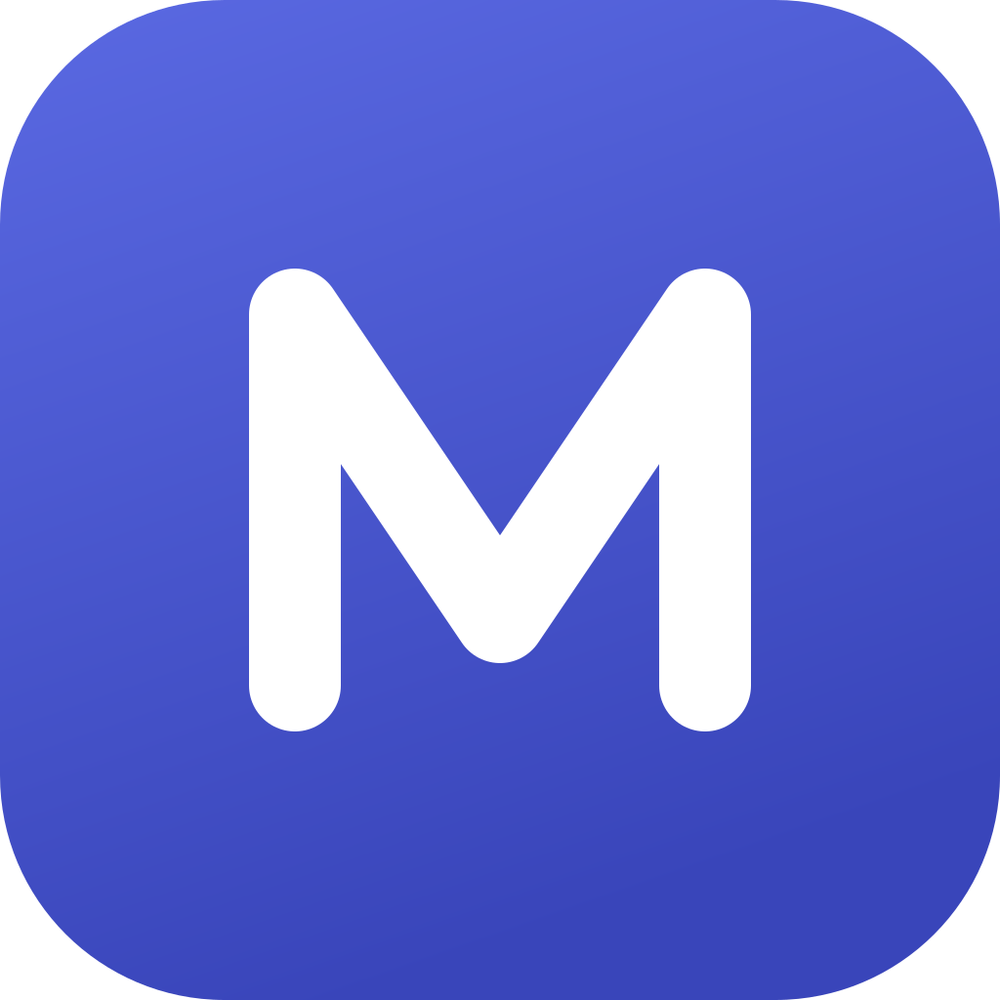
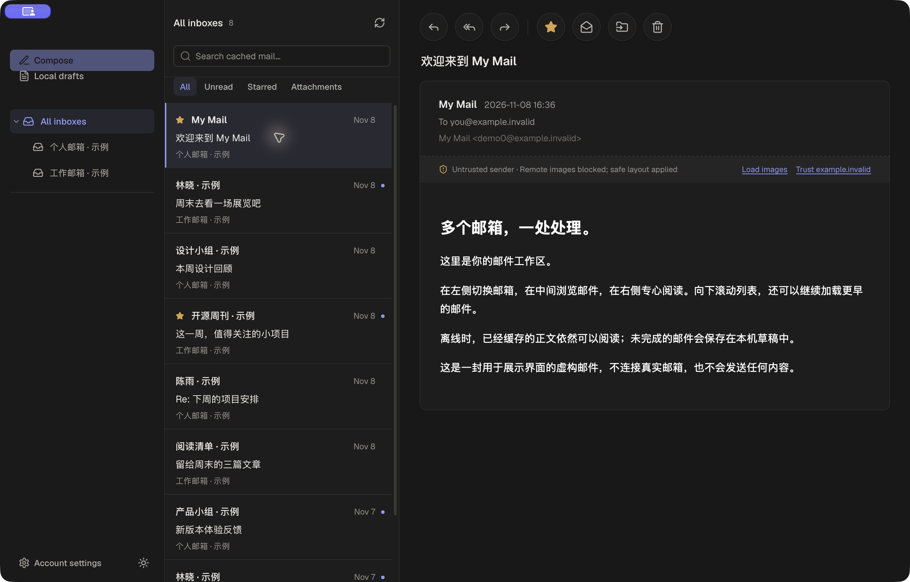
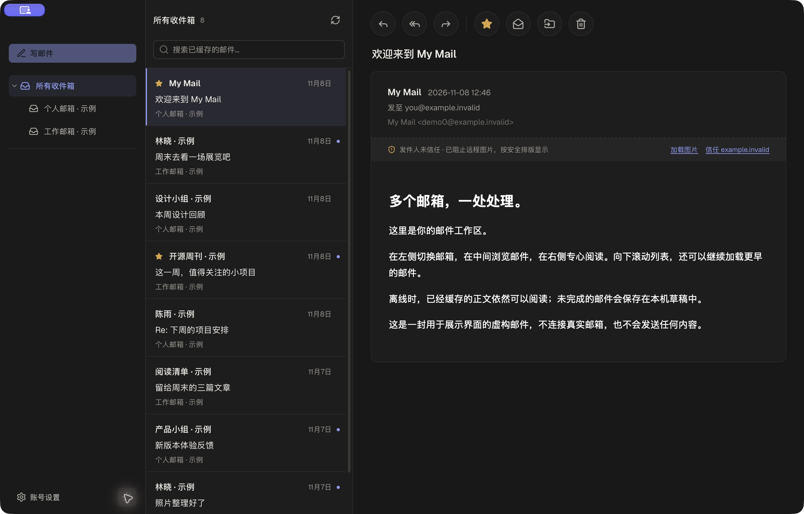

<p align="center"></p>
<h1 align="center">My Mail</h1>
<p align="center">A lightweight, local-first desktop email client built with MyGo and React.<br>Multiple inboxes. Offline reading. Your own IMAP server.</p>
<p align="center">
  <a href="https://github.com/yinxianwei/mymail/actions/workflows/ci.yml"></a>
  <a href="LICENSE"></a>
  
  <a href="https://github.com/yinxianwei/mymail/releases"></a>
</p>
<p align="center">
  English · <a href="README.zh-CN.md">简体中文</a><br>
  <a href="https://github.com/yinxianwei/mymail/releases">Downloads</a> ·
  <a href="docs/ROADMAP.md">Roadmap</a> ·
  <a href=".github/CONTRIBUTING.md">Contribute</a> ·
  <a href="https://github.com/yinxianwei/mymail/issues">Feedback</a>
</p>



## Why My Mail?

An email client with a small, understandable stack: Go handles IMAP, SMTP,
MIME and SQLite; React renders inside the operating system's WebView. There
is no bundled Chromium, hosted mail backend or My Mail account to create.

My Mail connects directly to your mail provider. It keeps cached mail and
drafts on your computer and stores mailbox credentials in the system credential
store. You can read the code, run it yourself and help shape what comes next.

## What works today

- **Multiple accounts, one inbox.** Read all inboxes together or focus on one
  account, with system folders first and collapsible custom folders.
- **Cached mail you can read offline.** Bodies load on demand; scrolling loads
  older headers in pages of 50. A virtualized list keeps the UI manageable.
  Filter cached rows by unread, starred or known attachments; search headers
  and cached attachment names together with a filter.
- **Everyday mail actions.** Reply, reply all, forward, star, mark read/unread,
  move and delete. Changes are queued locally for IMAP synchronization.
- **Compose without losing your draft.** Per-message local drafts, To/Cc/Bcc,
  attachments and ⌘/Ctrl + Enter to send. Sending uses plain text with an escaped
  HTML alternative; it is not a rich-text editor.
  The local draft manager lists drafts across accounts and lets you resume or
  confirm deletion without changing server-side drafts.
- **Preview attachments.** View images, paginated PDFs and text files locally.
  Click a filename to download it; cached attachments also work offline.
- **Stay informed.** Menu bar unread count, system notifications and IMAP IDLE
  with polling fallback. Notifications show counts rather than email content.
- **A focused desktop interface.** Light/dark themes, keyboard-friendly dialogs,
  `mailto:` links and configurable cache limits.

<details>
<summary>Dark mode</summary>



</details>

## Try it

**Early preview · macOS Apple Silicon · English / Chinese interface.** Windows, Linux and
Intel Mac desktop releases have not been validated. OAuth2 login, including
Outlook and Gmail OAuth, is not implemented. Provider compatibility is still
being tested; working local protocol tests are not a provider certification.

1. Open [Releases](https://github.com/yinxianwei/mymail/releases) and choose a
   macOS arm64 DMG if a preview has been published. Until then, build from source.
2. Open the DMG and drag **My Mail** into Applications.
3. Choose **Open local demo / 打开本地示例** to explore without credentials, or add an IMAP/SMTP
   account using your provider's app password / authorization code.

Automated preview builds are ad-hoc signed and **not notarized by Apple**.
macOS may block opening them; see [installation and verification](docs/INSTALL.md).
Do not disable system-wide security protections to try the app.

## Run from source

Use the Go version in [go.mod](go.mod), Bun from [.bun-version](.bun-version),
and macOS with Xcode Command Line Tools. Python 3 is used for repository checks
and optional screenshot fixtures, not by the application itself.

```sh
git clone https://github.com/yinxianwei/mymail.git
cd mymail
bun install --frozen-lockfile
bun run dev
```

The desktop app and Vite start together. `bun run dev:web` is for interface
development; a normal browser has no native mail bridge.

```sh
bun run test          # Go + frontend tests; local protocol servers only
bun run build:web     # TypeScript check + Vite build
bun run build         # Desktop app + DMG, including dependency notices
```

Build output: `build/darwin-arm64/`. See the [development guide](docs/DEVELOPMENT.md)
for isolated data, bindings, diagnostics and the project layout.

In **Account settings → Language**, choose **System default**, **English** or
**简体中文**. Changes apply immediately and are saved for the next launch.
Mail content and custom folder names keep their original language.

## Data and security

Mail cache and drafts live in a local SQLite database. **The database is not
encrypted by this app.** Credentials are stored separately in the system
credential store. Logs omit credentials, addresses and message content.

Email HTML is sanitized with DOMPurify and rendered in an opaque-origin sandbox
with CSP. Sender scripts are removed. **Remote images can still disclose that a
message was opened:** the current default trusts common provider/account domains,
and that trust does not verify SPF, DKIM or DMARC. Set remote images to **never**
in preferences for stricter behavior. See [security policy](.github/SECURITY.md).

## Help build it

The most useful contributions right now are provider compatibility reports,
reproducible bugs, accessibility fixes and platform testing. Start with the
[roadmap](docs/ROADMAP.md) and [contribution guide](.github/CONTRIBUTING.md).

If My Mail is useful to you, a **Star** helps others discover it. Sharing a
real experience or a useful issue helps just as much.

## License and thanks

[MIT](LICENSE). Built on [MyGo](https://github.com/egoist/mygo),
[React](https://react.dev), [grweb](https://github.com/yinxianwei/grweb),
[Emersion's mail libraries](https://github.com/emersion),
[modernc SQLite](https://pkg.go.dev/modernc.org/sqlite), Radix, Tailwind CSS,
DOMPurify, Lucide and Geist. Their licenses remain in effect; see
[third-party notices](docs/THIRD_PARTY_NOTICES.md).
