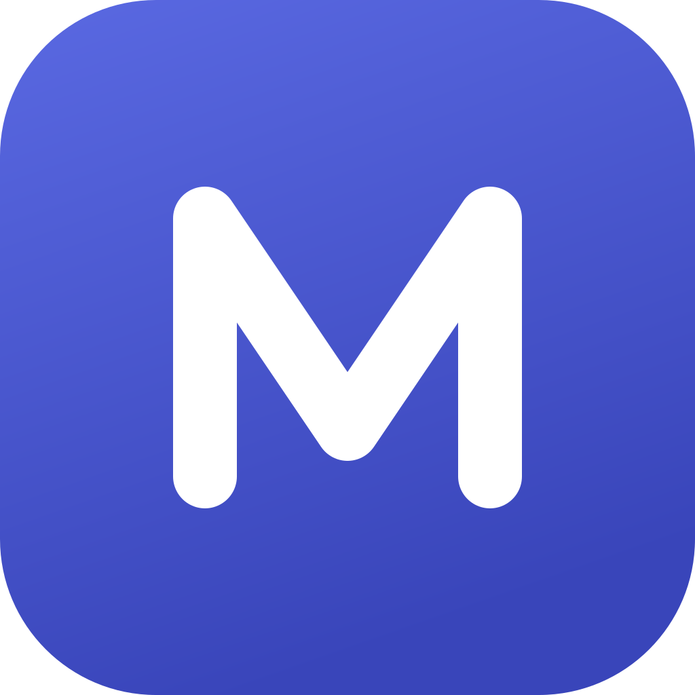
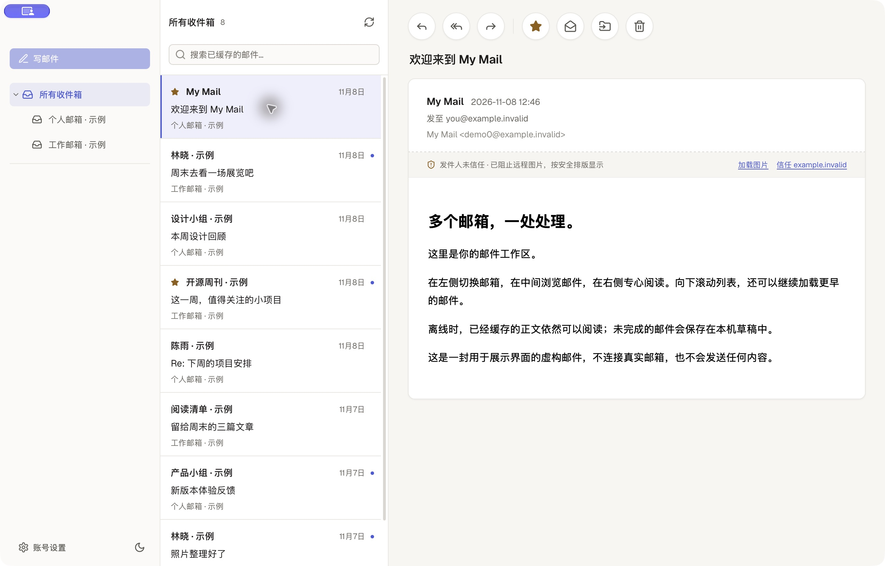
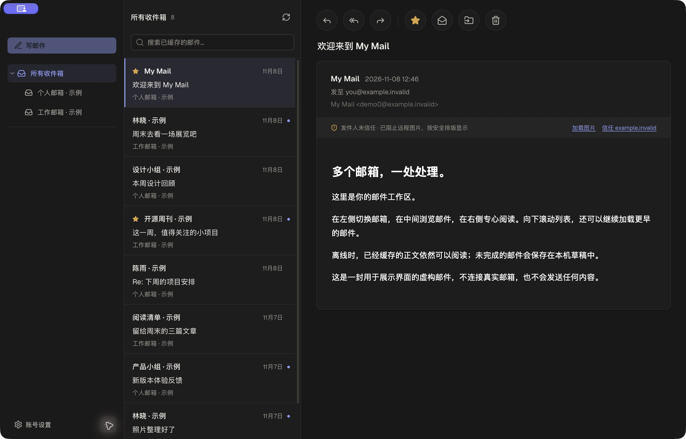

<p align="center"></p>
<h1 align="center">My Mail</h1>
<p align="center">基于 MyGo 和 React 的轻量、本地优先桌面邮箱。<br>多个收件箱，离线阅读，连接你自己的 IMAP 邮箱。</p>
<p align="center">
  <a href="https://github.com/yinxianwei/mymail/actions/workflows/ci.yml"></a>
  <a href="LICENSE"></a>
  
  <a href="https://github.com/yinxianwei/mymail/releases"></a>
</p>
<p align="center">
  <a href="README.md">English</a> · 简体中文<br>
  <a href="https://github.com/yinxianwei/mymail/releases">下载</a> ·
  <a href="docs/ROADMAP.md">路线图</a> ·
  <a href=".github/CONTRIBUTING.md">参与贡献</a> ·
  <a href="https://github.com/yinxianwei/mymail/issues">反馈问题</a>
</p>



## 为什么做 My Mail

想做一个技术栈清楚、可以自己运行和修改的桌面邮箱：Go 负责 IMAP、SMTP、MIME 和 SQLite，React 运行在系统 WebView 中。无需捆绑 Chromium，无需注册 My Mail 账号，也不经过项目方的邮件服务器。

应用直接连接你的邮箱服务商。缓存和草稿保存在本机，密码或授权码使用系统凭证库。你可以阅读源码，也可以一起决定它接下来该做什么。

## 现在能做什么

- **多个邮箱，一个收件箱。** 汇总查看或按账号阅读，常用系统文件夹固定排序，自定义目录支持层级展开。
- **离线阅读与历史加载。** 正文按需缓存，向下滚动每次加载更早的 50 封邮件头，列表使用虚拟滚动。
- **邮件筛选。** 按未读、星标或已缓存附件信息筛选，可叠加主题、发件人、收件人和附件名关键词，仅查询当前已缓存的列表。
- **日常邮件管理。** 回复、回复全部、转发、星标、已读/未读、移动和删除；管理操作先保存在本机，再排队同步到 IMAP。
- **写到一半也能继续。** 每封信独立保存本地草稿，支持收件人、抄送、密送、附件和 ⌘/Ctrl + Enter 发送。目前是纯文本写信，附带转义的 HTML 版本，尚无富文本编辑器。
- **附件预览。** 本地查看图片、可翻页的 PDF 与文本文件；点击文件名即可下载，已缓存附件离线也可使用。
- **本地草稿管理。** 统一查看各账号的未完成草稿，回到所属邮箱继续编辑，或确认删除；与服务器草稿分开处理。
- **菜单栏与新邮件通知。** 显示未读数，支持 IMAP IDLE 与轮询兜底，系统通知只显示数量。
- **桌面体验。** 深浅主题、键盘操作、`mailto:` 链接和可设置的缓存上限。

<details>
<summary>查看深色模式</summary>



</details>

## 下载体验

**当前为早期预览版，支持中英文界面，已验证环境是 macOS Apple Silicon。** Windows、Linux 和 Intel Mac 的桌面发行尚未验证。尚未实现 OAuth2，不能把 Outlook / Gmail OAuth 登录列为已支持；服务商兼容性仍在收集，本地协议测试不等于真实邮箱验收。

1. 到 [Releases](https://github.com/yinxianwei/mymail/releases) 下载已发布的 macOS arm64 DMG；首次发行前可从源码运行。
2. 打开 DMG，将 **My Mail** 拖入“应用程序”。
3. 选择“打开本地示例”即可体验；连接真实邮箱时，请先在服务商后台启用 IMAP / SMTP，并按要求生成授权码或应用密码。

自动构建的预览包使用临时签名，**未经过 Apple 公证**，可能被 macOS 阻止打开。操作与校验方法见[安装说明](docs/INSTALL.md)，无需关闭系统整体的安全防护。

## 从源码运行

使用 [go.mod](go.mod) 中的 Go 版本、[.bun-version](.bun-version) 中的 Bun，以及装有 Xcode Command Line Tools 的 macOS。Python 3 用于仓库检查与可选的截图示例，不是应用运行依赖。

```sh
git clone https://github.com/yinxianwei/mymail.git
cd mymail
bun install --frozen-lockfile
bun run dev
```

该命令同时启动桌面窗口和 Vite。`bun run dev:web` 仅供界面开发，普通浏览器不能独立完成邮件操作。

```sh
bun run test          # Go 与前端测试，仅使用本地协议服务器
bun run build:web     # 类型检查与前端构建
bun run build         # 桌面应用与 DMG，附带依赖许可证
```

产物位于 `build/darwin-arm64/`。开发与日志排查见[开发指南](docs/DEVELOPMENT.md)，完整功能细节见[使用指南](docs/user-guide.zh-CN.md)。

在“账号设置 → 语言”中选择“跟随系统 / 简体中文 / English”，立即生效并在下次启动时保留。邮件原文与自定义文件夹名称保持原样。

## 数据与安全

邮件缓存和草稿位于本机 SQLite，**应用没有对数据库额外加密**；凭证单独存入系统凭证库。诊断日志不记录密码、授权码、邮箱地址或邮件内容。

邮件 HTML 经 DOMPurify 清洗，放在不透明源的 sandbox 与 CSP 中显示，邮件自身的脚本会被移除。**远程图片仍可能向发件人透露打开邮件的时间等信息**：当前默认信任常见服务商与账号域名，但没有验证 SPF / DKIM / DMARC。需要更严格的行为时，可在设置里将远程图片改为“从不加载”。更多内容见[安全说明](.github/SECURITY.md)。

## 一起完善它

目前最需要真实服务商兼容性反馈、可复现的问题、无障碍改进和平台测试。可以从[路线图](docs/ROADMAP.md)与[贡献指南](.github/CONTRIBUTING.md)开始。

如果这个项目对你有用，欢迎点个 **Star**，让更多人发现它；一条真实的使用反馈同样很有帮助。

## 协议与致谢

采用 [MIT 协议](LICENSE)。感谢 [MyGo](https://github.com/egoist/mygo)、[React](https://react.dev)、[grweb](https://github.com/yinxianwei/grweb)、[Emersion 邮件库](https://github.com/emersion)、[modernc SQLite](https://pkg.go.dev/modernc.org/sqlite)、Radix、Tailwind CSS、DOMPurify、Lucide 和 Geist。第三方代码与字体保留各自的许可证，见[第三方声明](docs/THIRD_PARTY_NOTICES.md)。
